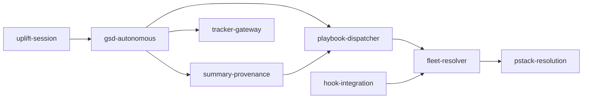

# Architecture Blueprint: pstack Autonomy Uplift inside gsd-autonomous (T3b18-arch)

Correlation: `3b18f741-390c-4422-bdd2-4b18499c4490` · Capability: `design.blueprint`
Upstream: `docs/requirements/spec-T3b18-req.md` (FR-1..FR-7, AC-41..AC-52, NFR-18..NFR-22)

## 1. Decision summary

- **Approach**: reuse the existing resolver chain (`src/cursor/pstack.ts` → `src/pstack/subagents.ts` → `src/claude/hook.ts`/`src/claude/output.ts` roster). No second resolver, no second roster format (AC-41: 0 second resolvers).
- **Inversion**: the current subagent-slot bridge (hook renders roster → agent spawns generics) becomes workflow-driven: `~/.agents/gsd-core/workflows/autonomous.md` execute steps per phase dispatch the `PLAYBOOK_ROUTES` playbook via the dispatcher, calling `resolveSubagentFleet` once per phase. `skills/poteto-autonomous/SKILL.md` stays the runner; its fleet-gate becomes the fail-open/fail-closed decision point owned by the workflow.
- **OQ1 resolved**: canonical strict flag `ULTRATHINK_PSTACK_STRICT=1` (env), config `pstack.strict: boolean` (default `false`), CLI alias `--pstack-required`. Default fail-open; only an explicit user-set value fails closed with a named reason (AC-45). Rationale in ADR.
- **No pre-plan dispatch** (FR-3): `uplift-session` gates `gsd-autonomous`; the dispatcher requires a phase PLAN context (fleet block or recorded fallback) before any `Task` spawn (AC-46).

## 2. C4 container model

| Container | Responsibility |
|---|---|
| `gsd-autonomous` | Phase loop discuss→plan→execute→review; owns TodoWrite/.planning/verify; per-phase dispatch call |
| `uplift-session` | `/ultrathink` planning; must land before Swarm starts |
| `hook-integration` | `src/claude/hook.ts` `pstackRosterFor` + `src/claude/output.ts` `formatPromptContext` tail |
| `fleet-resolver` | `src/pstack/subagents.ts` `resolveSubagentFleet` + `renderSubagentRoster` (single resolver) |
| `pstack-resolution` | `src/cursor/pstack.ts` `resolvePstack`/`skillPath`/`DEFAULT_MAPPING`/`detectStage` |
| `playbook-dispatcher` | In-phase dispatch: playbook lookup, one background Task per wave unit, GSD ownership discipline |
| `summary-provenance` | One-line phase summary (playbook+fleet/fallback+outcome) + per-unit provenance in SUMMARY |
| `tracker-gateway` | `src/track/gateway.ts` + `create.ts`/`closeSubIssue` — only tracker write path (FR-7) |

Relations: gsd-autonomous→playbook-dispatcher, gsd-autonomous→summary-provenance, gsd-autonomous→tracker-gateway, summary-provenance→playbook-dispatcher, playbook-dispatcher→fleet-resolver, hook-integration→fleet-resolver, fleet-resolver→pstack-resolution, uplift-session→gsd-autonomous.

Fitness: `arch_c4_fanout` SUCCESS — 8 containers, 8 relations, max fan-out 3, budget 4, over_budget=[], isolated=[].

Mermaid (level 2):



## 3. Layering and dependency rules

`layer_order` (outermost → innermost): `workflow, hook, dispatch, fleet, resolution, track, config`.

Assignments: gsd-autonomous/summary-provenance→workflow; hook-integration→hook; playbook-dispatcher→dispatch; fleet-resolver→fleet; pstack-resolution→resolution; tracker-gateway→track; pstack-config→config.

Edges (9 checked): gsd-autonomous→playbook-dispatcher, →summary-provenance, →tracker-gateway; summary-provenance→playbook-dispatcher; playbook-dispatcher→fleet-resolver; hook-integration→fleet-resolver; fleet-resolver→pstack-resolution, →pstack-config; tracker-gateway→pstack-config.

Fitness: `arch_layer_violations` 0 violations; `arch_cycle_check` has_cycle=false (8 nodes). New modules join the inward-only rule: workflow may dep on dispatch/fleet/resolution/config/track; nothing inner may dep outward. In particular the dispatcher never imports `src/claude/hook.ts` (hook→dispatcher is forbidden; the workflow calls the dispatcher, the hook only renders the shared roster).

## 4. Typed fleet-outcome contract (FR-6) — see `contracts/pstack-dispatch.openapi.json`

```ts
export type FleetState = "ok" | "disabled" | "unresolvable" | "forced-off" | "blocked";
export type FleetFallback = "vanilla" | "blocked";
export type PhaseType = "discuss" | "plan" | "execute" | "review";

export interface FleetOutcome {
  state: FleetState;              // explicit, never empty (AC-49)
  ok: boolean;                    // back-compat with SubagentFleet.ok
  reason: string;                 // back-compat human reason (kept, never dropped)
  reasonCode?: FleetState;        // machine reason, == state when !ok
  fallback: FleetFallback;        // derived from strict flag + state
  strict: boolean;                // ULTRATHINK_PSTACK_STRICT=1 | pstack.strict | --pstack-required
  playbook?: string;              // PLAYBOOK_ROUTES title for the phase type (FR-1)
  fleet?: SubagentFleet;          // the existing fleet payload when state === "ok"
  roster?: string | null;         // renderSubagentRoster output or null when > cap
  summaryLine?: string;           // one-line provenance for the phase SUMMARY (FR-5)
}
export interface PhaseDispatchRecord {
  phaseType: PhaseType; playbook: string; state: FleetState;
  fallback: FleetFallback; strict: boolean; reason: string;
  units: Array<{ unit: string; outcome: "landed" | "blocked" | "failed"; detail?: string }>;
}
```

Route table (pinned, `PLAYBOOK_ROUTES`): discuss→`investigation` (roster skill `how`), plan→`multi-phase-plan` (`architect`/`arena`), execute→`feature` (`tdd`), review→`shipping` (`interrogate`/`no-comments`). The brief's discuss=`how` is the `how` skill, not a playbook — no `how` playbook exists or is created (spec A2).

Fail-open rule: `state != ok && !strict → fallback: vanilla` (phase continues, reason recorded in SUMMARY, AC-44). `state != ok && strict → fallback: blocked` (phase stops, named reason, 0 vanilla units, AC-45). `blocked` additionally means resolution succeeded but a selected playbook file is absent (AC-48) or a unit is red and retries exhausted (AC-50: phase does not advance).

Backward compatibility: `SubagentFleet` shape is unchanged; `FleetOutcome` wraps it additively. `arch_field_breaks` (response): breaking_change=false, additive=[state, fallback, playbook]. `arch_semver_bump` 1.2.0→1.3.0 (minor, compliant).

## 5. Orchestration order (FR-3)

`uplift-session` (planning) → uplifted prompt lands → Swarm starts → `gsd-autonomous` phases → per-phase dispatch inside phases. The workflow file gets an explicit guard: dispatch step checks for phase PLAN context; when absent it records `blocked: no phase PLAN` and spawns 0 subagents (AC-46). No dispatch occurs before the plan exists; poteto autonomy never runs before plan.

## 6. Observability (FR-5, NFR-20)

One summary line per completed phase, plain text (NFR-20: 0 color-only meanings), e.g.:

```
phase=execute playbook=feature fleet=tdd outcome=landed units=3/3 fallback=none
phase=plan playbook=multi-phase-plan fleet=fallback reason="pstack cache not found" outcome=vanilla
```

Per-unit provenance (phaseType, playbook, outcome) is recorded in the phase SUMMARY before completion; a phase without a provenance section is not done. No silent truncation: caps surface an explicit marker, as `truncateXml` does for RATIONALE.

## 7. NFR allocation (100% via `arch_nfr_allocation`)

| NFR | Binding | Limit/verifier |
|---|---|---|
| NFR-18 perf | `FleetOutcome.resolve` clause | ≤1000 ms warm cache, 0 retries after first reason (A08.unit) |
| NFR-19 security | `summary-provenance.redact` clause | 0 secrets, 100% redaction (secret scan, A08.security) |
| NFR-20 a11y | `summary-provenance.line` clause | plain text, 0 color-only (A08.unit) |
| NFR-21 i18n | `dispatch.copy` clause | en-US (A08.unit) |
| NFR-22 compliance | `blueprint.supply-chain` component budget | 0 new first-party deps, AGPL headers (A08.compliance) |

`arch_nfr_budget`: 3 measured/checked, within_budget=true (fleet_resolve_ms 5 ≤ 1000, secret_findings 0 ≤ 0, new_deps 0 ≤ 0). No latency SLO for the autonomous run itself (bounded by model/tracker, spec §4).

## 8. Tech stack (from approved catalog, no new dependency)

TypeScript/Bun (existing), `src/pstack/subagents.ts` + `src/cursor/pstack.ts` (existing, pure, never-throws), workflow markdown edit (no new runtime), tracker gateway (existing). NFR-22: 0 new first-party dependencies. SBOM: existing inventory (`plugin/inventory.ts`); dependency allowlist: pstack v0.15.46 plugin cache (MIT, `cursor/plugins`); licenses: AGPL-3.0-or-later preserved on every changed file. No STRIDE surface beyond trust boundary pstack-cache→executor: cache is untrusted input — paths are resolved against `resolvePstack` root only, never interpolated into shell; roster lines are plain text, secrets redacted (NFR-19). A10 co-sign requested for the cache-trust design.

## 9. Fitness functions for CI

1. Layering: `arch_layer_violations` must stay 0 (any inner→outer edge blocks).
2. Cycles: `arch_cycle_check` must stay acyclic.
3. Fan-out: `arch_c4_fanout` budget 4.
4. Contract: `arch_contract_check` on `contracts/pstack-dispatch.openapi.json` green; no breaking change without major bump + consumer ack.
5. `arch_nfr_allocation` coverage 100%.
6. Quality gates: `bun run check`, `biome check --error-on-warnings`, `knip --include exports,types`, `bun test` (AC-51); 0 second resolvers (grep `resolvePstack` outside `cursor/pstack.ts`+`pstack/subagents.ts` = 0).

## 10. Hand-off to implementers

- A05: add `FleetState`/`FleetOutcome`/`PhaseDispatchRecord` types + `resolveFleetOutcome` wrapper around `resolveSubagentFleet` (new file `src/pstack/outcome.ts`, knip-clean: export only what hook/dispatcher import), wire `ULTRATHINK_PSTACK_STRICT`/`pstack.strict`/`--pstack-required` parsing in `mergePstack`, dispatcher + workflow edit, SUMMARY provenance writer. Tests per AC-41..AC-50.
- A06/A04 (parallel UX lane): tokens/phase-summary lines/a11y NFR-20 rendering — consume `FleetOutcome.summaryLine` and `PhaseDispatchRecord` from §4, no new types.
- A07: no schema/DLD (out of scope); data-model conflicts → arbitration via A01.

## 11. Risks

- Workflow file lives at `~/.agents/gsd-core/workflows/autonomous.md` (outside repo): the PR edits the repo copy that installs it; verify install path drift with A11.
- pstack v0.15.46 playbooks: missing playbook file per stage → per-unit `blocked` (AC-48), never improvise.
