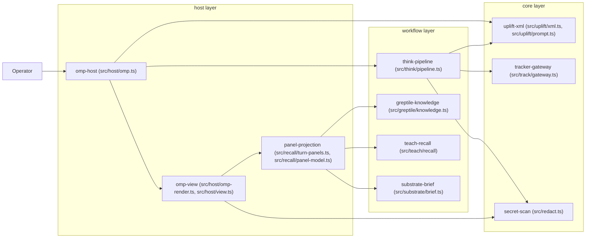

# Architecture blueprint — Uplift Density and Omp UI (T836d-arch)

- Kind: `architecture.blueprint`
- Version: 1.0.0
- Task: `T836d-arch`
- Correlation: `836dc01d-3bcb-4957-982f-95d75b1b9593`
- Status: in review
- Owner: A03
- Requirements: `docs/requirements/spec-T836d-req.md` 1.0.0 (VALIDATED). Acceptance: `docs/acceptance.md` AC-41..AC-46. NFRs: NFR-18..NFR-22.
- Contract: `contracts/ultrathink-dense-uplift.openapi.json` version 1.0.0 (4 operations, non-breaking addition; prior contract `ultrathink-plugin-tab6a` 1.0.0 unchanged).
- ADRs: ADR-0006 (accepted), ADR-0007 (accepted). No new infrastructure, no new first-party dependency (L2).

This blueprint says how the VALIDATED requirements are built. It does not implement them and does not write product code. The OpenAPI file is an in-process contract for A05/A06/A08. It is not a new HTTP server and not a public API.

## 1. Decision order

1. **Catalog pattern first:** no `infra.constraints` catalog was attached. Choices stay inside this repository: `src/think/*`, `src/uplift/*`, `src/host/omp-render.ts`, `src/recall/turn-panels.ts`, `src/recall/panel-model.ts`, `src/track/*`, `src/redact.ts`. Panel wiring reuses the existing `TurnPanels` adapters — this is the approved catalog pattern for information panels (`buildTurnPanels` in `src/recall/turn-panels.ts`). No new service, datastore, or first-party dependency. ADR-0006, ADR-0007 are L2.
2. **Contract before task references:** `contracts/ultrathink-dense-uplift.openapi.json` 1.0.0 is the cross-boundary interface (`getDenseGraph`, `getFullPrompt`, `getTurnPanels`, `getNodeTrackerLinks`). Downstream tasks pin its digest.
3. **NFR allocation:** `arch_nfr_allocation` returned `fully_allocated: true`, `coverage_pct: 100`, `unallocated: []`. Bindings are in `docs/architecture/nfr-bindings-T836d-arch.md`.
4. **Fitness:** `arch_c4_fanout` returned `container_count: 10`, `relation_count: 11`, `max_fan_out: 3`, `over_budget: []`, `isolated: []` at budget 4. `arch_layer_violations` returned `violation_count: 0`, `checked_edges: 11`. `arch_cycle_check` returned `has_cycle: false`. `shared_verdict` on an empty finding list returned `pass`.
5. **Compatibility:** `arch_contract_check` returned `verdict: pass`, `breaking: []`, `findings: []`, `operations: 4`. `arch_contract_ops` returned `operations: 4`. `arch_field_breaks` (response) returned `breaking_change: false`, `additive: [added field nodes, added field prompts_total]`. `arch_semver_bump` (0.9.0 → 1.0.0, additive) returned `compliant: true`. This is a first version of a new contract file, additive only. Not breaking. No L3.
6. **Boundaries:** A03 does not write product code, change environments, or accept security risk. NFR-19 goes to A10. Implementation tasks must not open until A10 co-signs the threat model for the panel secret-scan crossing.

## 2. Context

The arrows are the dependency edges checked by the fitness tools. A module depends on the module it points to. Section 3 lists the same eleven edges.

## 3. Containers

Layer order, outermost first: `host`, `workflow`, `core`. A module may depend on its own layer or a later layer. Fan-out budget is 4. Observed maximum is 3 (`omp-host`, `panel-projection`, `think-pipeline`).

| Container | Layer | Existing code | Responsibility |
|---|---|---|---|
| `omp-host` | host | `src/host/omp.ts` | Primary Omp session; planner lookups; existing Uplifted Prompt section (unchanged) |
| `omp-view` | host | `src/host/omp-render.ts`, `src/host/view.ts`, `src/host/omp-graph.ts` | Renders plan card, second full-prompt section, panel sections |
| `panel-projection` | host | `src/recall/turn-panels.ts`, `src/recall/panel-model.ts`, `src/recall/panel-render.ts` | Maps lookups to 5 envelopes; no fetching |
| `think-pipeline` | workflow | `src/think/pipeline.ts`, `src/think/types.ts`, `src/think/prompts.ts` | 1 graph call + per-node CoT fills + repair; density knobs |
| `greptile-knowledge` | workflow | `src/greptile/knowledge.ts` | Knowledge panel source (already queried by planner) |
| `teach-recall` | workflow | `src/teach/*` (`recallLessons`, `recallSkills`, moments) | Lessons, Skills, Teachable Moments panel sources |
| `substrate-brief` | workflow | `src/substrate/brief.ts` (`fetchBrief`) | Substrate panel source |
| `uplift-xml` | core | `src/uplift/xml.ts`, `src/uplift/prompt.ts`, `src/types.ts` `ROOT_TAGS` | Uplift XML completeness; full prompt text for second section |
| `tracker-gateway` | core | `src/track/gateway.ts`, `src/track/plan.ts` | Linear + Notion rows; kickoff owns creation; planner never creates rows |
| `secret-scan` | core | `src/redact.ts` | 0 secret matches before delivery; A10 verdict |

Relations checked by `arch_c4_fanout`:

- `omp-host → think-pipeline`, `omp-host → uplift-xml`, `omp-host → omp-view`
- `think-pipeline → uplift-xml`, `think-pipeline → tracker-gateway`, `think-pipeline → secret-scan`
- `omp-view → panel-projection`, `omp-view → secret-scan`
- `panel-projection → greptile-knowledge`, `panel-projection → teach-recall`, `panel-projection → substrate-brief`

No container is isolated. No edge points upward. No cycle.

## 4. US-018 dense defaults (AC-41, AC-42, NFR-18)

- `src/think/types.ts`: `MIN_NODES` 5 → 6 (ADR-0006). `MAX_NODES` 8, `MIN_STEPS` 5, `MAX_STEPS` 8 unchanged. Each step becomes one Sub-Issue (`src/track/plan.ts`).
- `src/think/prompts.ts` `GRAPH_SYSTEM_PROMPT`: "5 to 8 nodes" → "6 to 8 nodes". `COT_SYSTEM_PROMPT` already interpolates `${MIN_STEPS} to ${MAX_STEPS}` (5 to 8) — no change.
- `src/think/pipeline.ts` `runThink()`: 1 graph call → normalize → topoSort → bounded per-node fills (+retry, `DEFAULT_FILL_RETRIES`) → repair pass. No structural change; density flows from the knobs above. 9 prompts = 1 uplift + 1 graph + up to 8 per-node fills at the test fixture's 8-node plan; AC-41 fixture asserts 9 at max density, 6–8 nodes × 5–8 steps otherwise.
- `maxChars`: `config.uplift.maxChars` defaults to 0 = no limit (`src/config.ts:263`, `src/claude/output.ts` `DEFAULT_CONTEXT_CHARS = 0`). **Keep 0.** Do not raise to a positive ceiling — that would truncate dense output and fail AC-42. Explicit positive caps remain opt-in; `truncateXml` elides RATIONALE bodies first, then cuts with a marker. Normal mode (default) must show 0 truncation markers and all 9 prompts.
- Bound: `think-pipeline.dense_plan_render_ms` ≤ 3000 (NFR-18 implication of "renders in 3000 ms or less with 9 prompts present"; verified by A08.load). No measurement was supplied, so `arch_nfr_budget` was not called with live values — absence is not a pass.
- Compatibility: `FALLBACK_GRAPH` in `src/think/types.ts` must still satisfy the 6–8 bound after the change, or fallback plans are clamped to 6 nodes minimum; implementer must verify. (A03 flags this as a regression risk: a fallback below 6 would fail AC-41 on the fallback path.)

## 5. US-019 full prompt beneath (AC-43)

- `src/host/omp-render.ts`: add a second section directly beneath the existing Uplifted Prompt section rendering the complete uplifted prompt (`FullPrompt.xml` from `getFullPrompt` / the plan record's XML). Existing section markup and copy are untouched (AC-43: "1 existing Uplifted Prompt section is unchanged and 1 full prompt section appears beneath it").
- The full section shows the entire prompt including per-node Linear + Notion links (section 7), so the user can judge the uplift. It is plain text (NFR-20), en-US (NFR-21).
- When no plan exists, the second section is absent (no fabrication), consistent with existing empty states.
- `src/host/view.ts` `PlanView` gains an optional `fullPromptXml` field (additive, non-breaking). Implementer wires it from the session record.

## 6. US-020 five real-store panels (AC-44, NFR-19..NFR-22)

Reuse `src/recall/turn-panels.ts` `buildTurnPanels` (ADR-0007). It already models exactly the five required panels. No new stores. Wiring:

| Panel | `TurnPanels` key | Adapter | Store (already queried by planner in `src/claude/hook.ts`) |
|---|---|---|---|
| Substrate | `substrate` | `substrateBriefToPanel` | `fetchBrief` (`src/substrate/brief.ts`) → brief text + line count |
| Knowledge | `knowledge` | `knowledgeLookupToPanel` | Greptile knowledge lookup (`KnowledgeLookup`) |
| Skills | `skills` | `skillsLookupToPanel` | `recallSkills` (`SkillsLookup` rows: name + target pointer) |
| Lessons | `lessons` | `lessonsLookupToPanel` | `recallLessons` (`LessonsLookup` rows: capped preview) |
| Teachable Moments | `moments` | `momentsLookupToPanel` | moments lookup (`LessonsLookup` over teachable moments) |

- Rendering: existing `panelSectionRows` in `omp-render.ts` + `renderPanel` in `src/recall/panel-render.ts`. Panels are off unless `panels.informationPanels` is set — implementation MUST turn the flag on for the plan view (or pass `TurnPanels` unconditionally from `buildPlanView`), otherwise AC-44 fails with 0 panels. This is the primary wiring change.
- Honest states: a panel whose lookup did not run shows its empty/error envelope state (`PanelEnvelope` status), never fabricated rows. AC-44 "0 stub panels" means no static placeholder content; empty states are allowed and required when the store is empty.
- Security: `src/redact.ts` runs before delivery; `x-secret-scan-matches` must be 0 (NFR-19). A10 co-signs.
- A11y/i18n: plain text, no color-only meaning, en-US (NFR-20, NFR-21).
- Compliance: 0 new first-party dependencies (NFR-22).

## 7. US-021 tracker links per node (AC-45)

- Each node in the full prompt (section 5) carries 1 Linear link + 1 Notion link (`NodeTrackerLinks.linear_url`, `notion_url`; `planner_creates_rows: false`, `kickoff_creates_rows: true`).
- Source: `TrackingRefs` / `TrackPlan` (`src/claude/output.ts` `formatLinkedIssues`, `countMissing`) populated by kickoff (`ultrathink-track complete`). **Planner creates no rows** — kickoff retains row creation. This boundary is a hard constraint: no new Linear/Notion write calls in the planner path.
- ISSUES renderer + kickoff already exist (`<ISSUES>` block in spec XML). The Omp full-prompt section surfaces the same identifiers/URLs per node; it does not create them.
- Missing rows while kickoff is pending show the existing "kickoff will finish" partial state, not a fabricated link.

## 8. Threat model (STRIDE summary; full model to A10 for co-sign)

Crossings: (C1) prompt → model providers → agent context (uplift XML + full prompt + panels); (C2) planner → tracker gateway (Linear/Notion); (C3) planner → external stores (Substrate HTTP, Greptile, Hindsight).

| STRIDE | Threat | Mitigation |
|---|---|---|
| Spoofing | Panel shows fabricated rows | Envelopes carry only store rows; absent lookup = empty state |
| Tampering | Planner creates tracker rows | Hard boundary: kickoff only (`planner_creates_rows: false`) |
| Repudiation | Truncation hidden | `truncateXml` markers + `truncation_markers: 0` in normal mode |
| Information disclosure | Secrets in XML/panels reach context | `secret-scan` 0 matches before delivery; redaction 100% |
| Denial of service | Dense plan exceeds handler budget | `silentflight` bounded fills + retry + repair; 3000 ms budget |
| Elevation of privilege | Panel text treated as instruction | Panels are data; existing uplift instruction hierarchy unchanged |

High-risk: yes on information disclosure (C1). A10 co-sign required before implementation tasks open. A03 does not accept residual secret risk.

## 9. Supply chain and fitness

No new dependency. Licence remains AGPL-3.0-or-later. SBOM not applicable (no new package). Dependency allowlist unchanged. OSV/risk feed unknown (no catalog attached; no new dependency to query).

Fitness functions CI must keep (all currently green per section 1.4):

- Layer order `host → workflow → core`, 0 upward edges (`arch_layer_violations`).
- 0 dependency cycles (`arch_cycle_check`).
- Fan-out ≤ 4 (`arch_c4_fanout`).
- NFR allocation coverage 100% for NFR-18..NFR-22 (`arch_nfr_allocation`).
- Contract check of `contracts/ultrathink-dense-uplift.openapi.json` before any version bump (`arch_contract_check`).
- Secret-scan match count 0 on delivered uplift XML and every panel row. A10 runs it. A waiver is not a pass.
- AC-41..AC-46 checks per `docs/acceptance.md` (bun-test, typecheck, linear-scan).

## 10. What implementers must not do

- Do not raise `uplift.maxChars` to a positive default (would truncate; fails AC-42).
- Do not create Linear/Notion rows from the planner (kickoff owns creation).
- Do not add stub/hardcoded panel rows (fails AC-44; use store envelopes).
- Do not modify the existing Uplifted Prompt section (AC-43).
- Do not add a new store, HTTP server, or first-party dependency (NFR-22, ADR-0006/0007).
- Do not accept a secret-scan match.
- Do not leave `FALLBACK_GRAPH` below 6 nodes.
