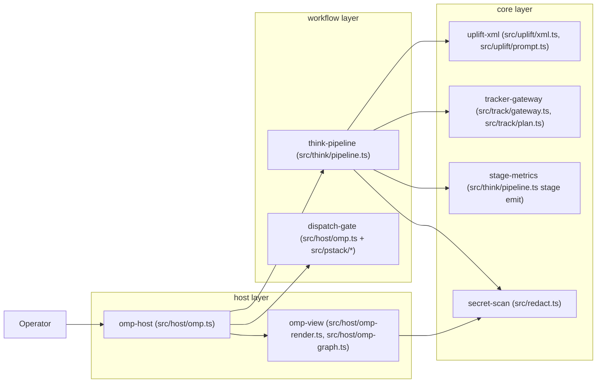

# Architecture blueprint — Dense 500-line XML Prompts via Double Uplift (Tdde6-arch)

- Kind: `architecture.blueprint`
- Version: 1.0.0
- Task: `Tdde6-arch`
- Correlation: `dde6accb-e288-424f-8913-cb429e5f88ef`
- Status: in review
- Owner: A03
- Requirements: `docs/requirements/spec-Tdde6-req.md` 1.0.0 (VALIDATED). Acceptance: `docs/acceptance.md` AC-53..AC-59. NFRs: NFR-23..NFR-27.
- Contract: `contracts/ultrathink-double-uplift.openapi.json` version 1.0.0 (4 operations, new file, non-breaking; prior contract `ultrathink-dense-uplift` 1.0.0 unchanged).
- ADR: ADR-0011 (accepted). No new infrastructure, no new first-party dependency (L2).

This blueprint says how the VALIDATED requirements are built. It does not implement them and does not write product code. The OpenAPI file is an in-process contract for A05/A06/A08. It is not a new HTTP server and not a public API.

## 1. Decision order

1. **Catalog pattern first:** no `infra.constraints` catalog was attached. Choices stay inside this repository: `src/think/pipeline.ts`, `src/uplift/xml.ts` + `src/uplift/prompt.ts`, `src/track/plan.ts`, `src/host/omp-graph.ts` + `src/host/omp-render.ts`, `src/redact.ts`. Double Uplift reuses the existing `runThink` stages and the existing `checkUpliftXml`/`sanitizeUpliftXml` gate — this is the approved catalog pattern for uplift (`ROOT_TAGS`/required-children in `src/uplift/xml.ts`). No new service, datastore, or first-party dependency. ADR-0011 is L2.
2. **Contract before task references:** `contracts/ultrathink-double-uplift.openapi.json` 1.0.0 is the cross-boundary interface (`getDoubleUpliftGraph`, `getStageMetrics`, `getFinalPrompt`, `getDispatchGate`). Downstream tasks pin its digest.
3. **NFR allocation:** `arch_nfr_allocation` returned `fully_allocated: true`, `coverage_pct: 100`, `unallocated: []`, `unmeasurable: []`. Bindings are in `docs/architecture/nfr-bindings-Tdde6-arch.md`.
4. **Fitness:** `arch_c4_fanout` returned `container_count: 8`, `relation_count: 8`, `max_fan_out: 4`, `over_budget: []`, `isolated: []` at budget 4. `arch_layer_violations` returned `violation_count: 0`, `checked_edges: 8`. `arch_cycle_check` returned `has_cycle: false`. `shared_verdict` on an empty finding list returned `pass`.
5. **Compatibility:** `arch_contract_check` returned `verdict: pass`, `breaking: []`, `findings: []`, `operations: 4`. `arch_contract_ops` returned `operations: 4`. `arch_field_breaks` (response) returned `breaking_change: false`, `additive: [added field line_count, added field linked_issues]`. This is a first version of a new contract file, additive only. Not breaking. No L3. (`arch_semver_bump` 1.0.0→1.0.0 returned `bump: none`, `compliant: false` for a same-version revision comparison; that comparison does not apply to a new file's first version and is not claimed as a pass.)
6. **Boundaries:** A03 does not write product code, change environments, or accept security risk. NFR-24 goes to A10. Implementation tasks must not open until A10 co-signs the threat model for the second-uplift secret-scan crossing.

## 2. Context

The arrows are the dependency edges checked by the fitness tools. A module depends on the module it points to. Section 3 lists the same eight edges.

## 3. Containers

Layer order, outermost first: `host`, `workflow`, `core`. A module may depend on its own layer or a later layer. Fan-out budget is 4. Observed maximum is 4 (`think-pipeline`).

| Container | Layer | Existing code | Responsibility |
|---|---|---|---|
| `omp-host` | host | `src/host/omp.ts` | Primary Omp session; owns dispatch gate; existing Uplifted Prompt section (unchanged) |
| `omp-view` | host | `src/host/omp-render.ts`, `src/host/omp-graph.ts` | Renders plan summary + full prompt beneath (PR #261, frozen), graph cards |
| `think-pipeline` | workflow | `src/think/pipeline.ts`, `src/think/types.ts` | GoT graph → per-node CoT → first uplift → ISSUES injection → second uplift → final XML; 10-prompt accounting |
| `dispatch-gate` | workflow | `src/host/omp.ts`, `src/pstack/*` | Blocks specialist/swarm dispatch until final prompt lands (0 before) |
| `uplift-xml` | core | `src/uplift/xml.ts`, `src/uplift/prompt.ts`, `src/types.ts` `ROOT_TAGS` | Uplift XML completeness; density bar; required children |
| `tracker-gateway` | core | `src/track/gateway.ts`, `src/track/plan.ts` | Linear (authoritative) + Notion rows; completion before ISSUES injection |
| `stage-metrics` | core | `src/think/pipeline.ts` stage emit | Per-stage line counts naming density-loss stage (FR-1) |
| `secret-scan` | core | `src/redact.ts` | 0 secret matches before delivery; A10 verdict |

Relations checked by `arch_c4_fanout`:

- `omp-host → think-pipeline`, `omp-host → dispatch-gate`, `omp-host → omp-view`
- `think-pipeline → uplift-xml`, `think-pipeline → tracker-gateway`, `think-pipeline → stage-metrics`, `think-pipeline → secret-scan`
- `omp-view → secret-scan`

No container is isolated. No edge points upward. No cycle.

## 4. Double Uplift sequence (FR-2, FR-4, AC-54, AC-56)

1. GoT graph: 1 prompt (`buildGraph` in `src/think/pipeline.ts`).
2. Per-node CoT: N prompts, N in 5..8 (7 default), each 5–8 steps (`MIN_STEPS`/`MAX_STEPS`), each carrying rationale + conclusion (`FillRejectedError` gate unchanged).
3. First uplift: 1 prompt over the graph payload (`xmlWithoutOriginal` strips the prior ORIGINAL so the payload carries the prompt once).
4. Tracker completion: kickoff-owned Linear/Notion rows complete; planner creates no rows (hard boundary carried from T836d).
5. ISSUES injection: tracker references injected into the first-uplift XML as the `<ISSUES>` input for pass 2.
6. Second full uplift: 1 prompt (the 10th at defaults) over the enriched XML.
7. Final XML-tagged prompt: the only renderable, dispatchable prompt.

Accounting (FR-4, AC-56): 1 graph + N node chains + 2 uplifts = 1 + N + 2; at N=7 that is 10. Written in code, in `StageMetrics.prompt_accounting`, and in the final prompt's accounting line, naming provider-limit and cost implications (one extra uplift call per run; bounded by existing fill retry/repair caps).

## 5. Density bar and presentation (FR-1, FR-3, FR-6, AC-53, AC-55, AC-57)

- FR-1 measurement: each stage emits `StageMetric{stage, lines}` (graph nodes, per-node rationale/conclusion, first uplift, ISSUES injection, second uplift, final XML); `density_loss_stage` names the stage where lines drop. Verified by AC-53 measurement-scan on 1 sample run.
- FR-3 final bar: `FinalPrompt.line_count` ≥ 500, `rationale_preserved_pct` = 100, `linked_issues` carries every tracker reference, `truncation_markers` = 0 in normal mode. `uplift.maxChars` stays 0 = no limit; do not raise to a positive ceiling.
- FR-6 / PR #261: the complete final prompt renders in one section beneath the plan summary (`src/host/omp-render.ts` full-prompt section, pinned by `omp-render.panels.test.ts` lines 184-209) with 100% of characters preserved and 0 truncation; tracker links render per node (`src/host/omp-graph.ts` cards). Existing Uplifted Prompt section markup/copy untouched. Plain text, no color-only meaning (NFR-25), en-US (NFR-26).

## 6. Dispatch gate (FR-5, AC-58)

`DispatchGate.specialists_before_final` = 0. No specialist or swarm dispatch starts before `final_prompt_landed` is true. `dispatch-gate` sits in workflow, downstream of `omp-host` only; it does not call back into `think-pipeline` (no cycle).

## 7. Threat model (STRIDE summary; full model to A10 for co-sign)

Crossings: (C1) prompt → model providers → agent context (first + second uplift XML + final prompt); (C2) planner → tracker gateway (Linear/Notion); (C3) stage metrics → logs/session XMLs.

| STRIDE | Threat | Mitigation |
|---|---|---|
| Spoofing | Second uplift invents tracker rows | ISSUES injection carries only gateway-returned references; planner creates none |
| Tampering | First vs second uplift diverge silently | `checkUpliftXml` required-children gate on both passes; stage metrics recorded per pass |
| Repudiation | Density loss hidden | Per-stage line counts + `density_loss_stage` in `StageMetrics` |
| Information disclosure | Secrets in XML/ISSUES reach context | `secret-scan` 0 matches before delivery; redaction 100% (NFR-24) |
| Denial of service | Second uplift exceeds handler budget | Local pass ≤ 1000 ms (NFR-23); retry/repair caps unchanged |
| Elevation of privilege | ISSUES text treated as instruction | ISSUES is data input to uplift; instruction hierarchy unchanged |

High-risk: yes on information disclosure (C1). A10 co-sign required before implementation tasks open. A03 does not accept residual secret risk.

## 8. Supply chain and fitness

No new dependency. Licence remains AGPL-3.0-or-later. SBOM not applicable (no new package). Dependency allowlist unchanged. OSV/risk feed unknown (no catalog attached; no new dependency to query).

Fitness functions CI must keep (all currently green per section 1.4):

- Layer order `host → workflow → core`, 0 upward edges (`arch_layer_violations`).
- 0 dependency cycles (`arch_cycle_check`).
- Fan-out ≤ 4 (`arch_c4_fanout`).
- NFR allocation coverage 100% for NFR-23..NFR-27 (`arch_nfr_allocation`).
- Contract check of `contracts/ultrathink-double-uplift.openapi.json` before any version bump (`arch_contract_check`).
- Secret-scan match count 0 on delivered final XML and every ISSUES payload. A10 runs it. A waiver is not a pass.
- AC-53..AC-59 checks per `docs/acceptance.md` (measurement-scan, bun-test, line-count, doc-check, typecheck).

## 9. What implementers must not do

- Do not raise `uplift.maxChars` to a positive default (would truncate; fails AC-55/AC-57).
- Do not create Linear/Notion rows from the planner (kickoff owns creation; Linear authoritative, Notion mirrors).
- Do not dispatch any specialist/swarm before the final prompt lands (fails AC-58).
- Do not truncate the full-prompt-beneath section in normal mode (fails AC-57 / PR #261).
- Do not add a new store, HTTP server, or first-party dependency (NFR-27, ADR-0011).
- Do not accept a secret-scan match.
- Do not claim a 500-line final XML without citing the measured line count in the PR (FR-7).
