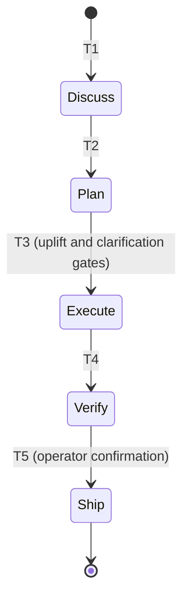

# Phase lifecycle state machine

Scope: `src/workflow/phase-loop.ts` as of phase 110 (247 lines). Line numbers refer to that file. Section 1 describes what the file does. Section 2 lists the transitions from ADR 0001 (`docs/adr/0001-persist-and-gate-the-phase-lifecycle.md`) with their status. Persistence is opt-in: a call persists only when it passes a store. No production caller in `src/` passes a store yet; only the phase-loop tests do.

## 1. Implemented

### 1.1 States

There is no explicit state field. The state is the `phaseOrder` prefix (`PhaseLoopState.phaseOrder`, L26). The current state is its last element.

| State | Reached when | Source |
|---|---|---|
| (empty) | `phaseOrder` is `[]`; `rowFor` creates the row | L76-83 (`rowFor`); L66-74 (`emptyState`) |
| Discuss | `phaseOrder[0]` | L7 (`PHASE_ORDER`) |
| Plan | `phaseOrder[1]` | L7 |
| Execute | `phaseOrder[2]` | L7, L113-114 |
| Verify | `phaseOrder[3]` | L7 |
| Ship | `phaseOrder[4]`, via `confirmShip` | L128 |

Ship is terminal. Every later attempt is refused: `PHASE_ORDER[5]` is undefined, so L108 refuses any phase, and L126 refuses `confirmShip` because the last element is Ship, not Verify. There is no Close, Checkpointed, Paused, or Failed state. A checkpoint is a field of the stored record, not a state (section 2, P2).

### 1.2 Transitions

| ID | From to To | Function | Guard | Effect | Persisted when a store is passed |
|---|---|---|---|---|---|
| T1 | (empty) to Discuss | `attemptPhase` (`applyAttempt`) | connected (L106); next in order (L108) | push (L113) | Yes, save at L156 |
| T2 | Discuss to Plan | `attemptPhase` (`applyAttempt`) | connected (L106); next in order (L108) | push (L113) | Yes, save at L156 |
| T3 | Plan to Execute | `attemptPhase` (`applyAttempt`) | connected (L106); next in order (L108); `completeUpliftCount >= 1` and `unansweredBlockingClarifications === 0` (L109-111) | push (L113); `executeStarts += 1` (L114) | Yes, save at L156 |
| T4 | Execute to Verify | `attemptPhase` (`applyAttempt`) | connected (L106); next in order (L108) | push (L113) | Yes, save at L156 |
| T5 | Verify to Ship | `confirmShip` (`applyShipConfirmation`) | `afterVerify` (L125); last element is Verify (L126); connected (L127) | push (L128); `shipStarts = 1` (L129); `operatorConfirmations += 1` (L130) | Yes, save at L156 |

Without a store, no transition is persisted. The in-memory `loops` map (L60-64) holds the row, and `rowFor` creates it (L147-149). When a store is passed, `transition` (L141-158) saves the whole row once, at L156, after an accepted change. The counter changes of an accepted transition therefore commit together. A refused attempt skips that save.

### 1.3 Refusals

A refused call returns a snapshot and leaves the state unchanged. With a store, a refusal writes nothing.

| ID | Refused when | Line |
|---|---|---|
| R1 | Runtime not connected (`attemptPhase`, `confirmShip`) | L106, L127 |
| R2 | `attemptPhase` with phase Ship | L107 |
| R3 | Phase is not the next in order | L108 |
| R4 | Execute gates unmet | L111 |
| R5 | `confirmShip` without `afterVerify` | L125 |
| R6 | `confirmShip` when the last element is not Verify, including a second confirmation after Ship | L126 |
| R7 (added in phase 110) | The stored record is quarantined: `attemptPhase` and `confirmShip` throw `PhaseLoopCorruptError` before any gate runs; `checkpointPhaseLoop` throws it too | L151-154 (`transition`); L209-212 (`checkpointPhaseLoop`) |

On the in-memory path, `rowFor` creates a row even on a refused call (L147-149). `attemptPhase` and `confirmShip` share that path through `transition` (L141-158).

### 1.4 Diagram

### 1.5 Observed gaps in the phase 110 file

- Persistence is opt-in. Without a store, nothing is persisted: the in-memory `loops` map (L60-64) holds the state, and a restart starts empty. With a store, a restart reads the last committed record (`restorePhaseLoop`, L223-242). Nothing in `src/` outside the phase-loop tests passes a store, so the running system does not persist yet.
- No caller invokes `checkpointPhaseLoop` (L203-215), so no pause or kill writes a checkpoint yet.
- `attemptPhase` guards Verify only by order and connection (L106, L108). No audit or validation is consulted.
- `confirmShip` (L186-195; gates at L125-127) consults no audit and no human item.
- Ship is the last state. No close transition exists.

## 2. Transitions from ADR 0001: status

Proposed states: **Checkpointed** and **Closed**. HTIL entries are a set attached to a phase; they are not a state. Phase 110 implements the checkpoint as a field of the stored record, so Checkpointed is not a state in the code.

### P1. Persist on transition (LIFE-01) — Implemented, opt-in (phase 110)

- Each accepted transition T1 to T5 and its counter writes (L113-114, L128-130) commit the `PhaseLoopState` before the call returns, in one save at L156, when a store is passed.
- Refusals R1 to R6 write nothing, because L156 is not reached. R7 writes nothing either.
- With a store, the store is the system of record. A restart reads the last committed state (`restorePhaseLoop`, L223-242). Without a store, the in-memory `loops` map (L64) is the only state.
- Storage: one JSON record per runtime id under a state directory (`fileStore` in `phase-loop-store.ts`). The ADR left the backend open; phase 110 chose this one.

### P2. Checkpoint on kill or pause; restore on resume (LIFE-04) — Implemented, opt-in (phase 110); no caller yet

- Pause or catchable kill: `checkpointPhaseLoop` (L203-215) saves the current state with `checkpoint: { reason, at }`. The reason is `pause` or `kill`, and `at` is the caller's time. The implemented state does not change, so there is no separate Checkpointed state.
- Resume: `restorePhaseLoop` (L223-242) returns the stored state and the checkpoint when one exists. The report carries the state fields (`phaseOrder`, `executeStarts`, `shipStarts`, `operatorConfirmations`) rather than a per-field list.
- A transition after a checkpoint saves a row from `snapshot` (L89-97), which carries no checkpoint field. The save at L156 therefore clears the checkpoint.
- A hard kill writes no checkpoint. Resume uses the last P1 commit.
- Not yet wired: no caller invokes `checkpointPhaseLoop`. The pause and kill hooks belong to the caller and are not in `src/`.

### P2a. Quarantine of a corrupt record — Added in phase 110; not in the ADR

- A record that is unparseable or of the wrong shape is renamed aside with its bytes kept (`fileStore`, `phase-loop-store.ts`). Its load reports `quarantined`.
- While the quarantined copy exists and no record is present, every transition and checkpoint throws `PhaseLoopCorruptError` (class at L48-58; thrown at L151-154 and L209-212). Nothing is written.
- `restorePhaseLoop` does not throw. It reports `quarantined` and the copy's location (L233-240).
- The block clears when a valid record is written over the record name or an operator removes the copy.

### P3. Audit gate before Close (LIFE-02) — Proposed (not implemented)

- **T6 (Ship to Closed).** Guard: a recorded audit or validation result exists for the phase, referenced by ID.
- **T6-override (Ship to Closed).** Guard: a recorded owner-decision record exists, referenced by ID. It replaces the audit guard.
- Neither record present: refused, state unchanged.
- Closed is terminal.
- The milestone-complete gate is out of repo, in gsd-core at `/root/.agents/gsd-core`. Its internals are not designed here.

### P4. Human items as HTIL entries (LIFE-05) — Proposed (not implemented)

- On entry to Verify (T4), each human-verification or owner-gated item becomes an HTIL entry with an ID, an owner, and a state.
- T5 and T6 are refused while any HTIL entry is open.
- An entry leaves the open set only by resolution or by a recorded owner decision. Both are recorded.

### P5. Single writer (LIFE-03) — Proposed (not implemented)

- LIFE-03 adds no transition to this machine.
- Any STATE.md or ROADMAP.md write that records a transition above goes through the one guarded writer. The writer is in gsd-core, out of repo. A concurrent write fails loudly.

### 2.1 Open items (not decided here)

- Whether a hard kill needs more than the last P1 commit.
- Where HTIL item sources come from (P4).
- The gsd-core interfaces for the milestone-complete gate and the writer (P3, P5).
- Storage backend: decided in phase 110 as file JSON (P1). The checkpoint format is a record field, `reason` and `at` (P2).
