# Phase lifecycle state machine

Scope: `src/workflow/phase-loop.ts` as of phase 111 (414 lines). Line numbers refer to that file. Phase 111 status: the audit gate on close (LIFE-02) and human items (LIFE-05) are implemented in `phase-loop.ts` and in the record schema of `phase-loop-store.ts`. The accepted close records the record it cites in `closedBy`. Section 1 describes what the file does. Section 2 lists the transitions from ADR 0001 (`docs/adr/0001-persist-and-gate-the-phase-lifecycle.md`) with their status. Persistence is opt-in: a call persists only when it passes a store. No production caller in `src/` passes a store yet; only the phase-loop tests do.

## 1. Implemented

### 1.1 States

There is no explicit state field. The state is the `phaseOrder` prefix (`PhaseLoopState.phaseOrder`, L79). The current state is its last element. HTIL entries (`humanItems`, L83) are a set held by the loop; they are not a state. `closedBy` (L85) is the record the accepted close cites; it is not a state.

| State | Reached when | Source |
|---|---|---|
| (empty) | `phaseOrder` is `[]`; `rowFor` creates the row | L122-131 (`emptyState`); L133-140 (`rowFor`) |
| Discuss | `phaseOrder[0]` | L7 (`PHASE_ORDER`) |
| Plan | `phaseOrder[1]` | L7 |
| Execute | `phaseOrder[2]` | L7; L175 (`executeStarts`) |
| Verify | `phaseOrder[3]` | L7 |
| Ship | `phaseOrder[4]`, via an accepted `confirmShip` | L7; L238 (push); L241 (`closedBy`) |

Ship is terminal and is the close. The phase 111 ADR text names a separate Closed state (P3). The code does not add one: the accepted `confirmShip` (T5) is the close, and it now needs an audit or override and no open HTIL entry. Every later attempt is refused: `PHASE_ORDER[5]` is undefined, so L167 refuses any phase, and L228-230 refuse `confirmShip`, because the last element is Ship, not Verify. There is no Checkpointed, Paused, or Failed state. A checkpoint is a field of the stored record, not a state (section 2, P2).

### 1.2 Transitions

| ID | From to To | Function | Guard | Effect | Persisted when a store is passed |
|---|---|---|---|---|---|
| T1 | (empty) to Discuss | `attemptPhase` (`applyAttempt`, L159-177) | connected (L165); next in order (L167-169) | push (L174) | Yes, save at L269 |
| T2 | Discuss to Plan | `attemptPhase` (`applyAttempt`) | connected (L165); next in order (L167-169) | push (L174) | Yes, save at L269 |
| T3 | Plan to Execute | `attemptPhase` (`applyAttempt`) | connected (L165); next in order (L167-169); `completeUpliftCount >= 1` and `unansweredBlockingClarifications === 0` (L170-173) | push (L174); `executeStarts += 1` (L175) | Yes, save at L269 |
| T4 | Execute to Verify | `attemptPhase` (`applyAttempt`) | connected (L165); next in order (L167-169) | push (L174) | Yes, save at L269 |
| T5 (the close) | Verify to Ship | `confirmShip` (`applyShipConfirmation`, L220-243) | `afterVerify` (L227); last element is Verify (L228-230); connected (L231); passing audit or owner override (L232-233, `closeRecord` L192-201 and `closeRefusals` L204-214); no open HTIL entry (L234-236) | push (L238); `shipStarts = 1` (L239); `operatorConfirmations += 1` (L240); `closedBy` set to the cited record (L241) | Yes, save at L269 |
| T-open | none (no phase change) | `open` (L318-334) | id and owner non-blank (L325-326); id not already used (L327-329) | push an entry in state `open` (L331) | Yes, save at L269 |
| T-resolve | none (no phase change) | `resolve` (L341-362) | entry exists and is `open` (L348-350); `done` has non-blank `evidenceId` (L351-352); `deferred` has non-blank `decisionId` (L357) | entry becomes `done` (L353-354) or `deferred` (L358-359) | Yes, save at L269 |

Without a store, `transition` (L253-271) applies the gates to the in-memory row from `rowFor` (L258-262). With a store, `transition` loads the row, runs the gates on a snapshot, and saves the whole row once, at L269, only when no gate refused. The counter changes and `closedBy` of an accepted transition therefore commit together, and a refused call skips that save.

### 1.3 Refusals

| ID | Refused when | Line |
|---|---|---|
| R1 | Runtime not connected (`attemptPhase`, `confirmShip`) | L165; L231 |
| R2 | `attemptPhase` with phase Ship | L166 |
| R3 | Phase is not the next in order | L167-169 |
| R4 | Execute gates unmet | L171-172 |
| R5 | `confirmShip` without `afterVerify` | L227 |
| R6 | `confirmShip` when the last element is not Verify, including a second confirmation after Ship | L228-230 |
| R7 (phase 111) | `confirmShip` with no passing audit that the call cites, and no complete owner override. A failed audit with no override is refused. A passing audit whose id differs from the cited id is refused | L232-233; `closeRefusals` L204-214 (L207-208 mismatch; L209-210 failed audit; L212 incomplete override) |
| R8 (phase 111) | `confirmShip` while any HTIL entry is open; the refusal names each open id | L234-236 |
| R9 (phase 111) | `open` with a blank id or owner, or an id already in use | L325-329 |
| R10 (phase 111) | `resolve` with an unknown id, an entry that is not open, `done` without `evidenceId`, or `deferred` without `decisionId` | L349-350; L352; L357 |
| R11 (phase 110; extended in 111) | The stored record is quarantined: `attemptPhase`, `confirmShip`, `open`, and `resolve` throw `PhaseLoopCorruptError` before any gate runs (L264-266); `checkpointPhaseLoop` throws it too (L376-378) | L264-266; L376-378 |

`confirmShip`, `open`, and `resolve` return every refusal reason in `refusals` (`GateOutcome`, L60-65). `attemptPhase` returns the state only: its reasons are computed (L165-175) and discarded (L289-291). A refused call returns a snapshot (L261, L270) and leaves the state unchanged, including `closedBy`. With a store, a refusal writes nothing. On the in-memory path, `rowFor` still creates a row on a refused call (L133-140).

### 1.4 Diagram

```mermaid
stateDiagram-v2
    [*] --> Discuss: T1
    Discuss --> Plan: T2
    Plan --> Execute: T3 (uplift and clarification gates)
    Execute --> Verify: T4
    Verify --> Ship: T5 (confirmation; audit or override; no open HTIL entry)
    Ship --> [*]
```

### 1.5 Observed gaps in the phase 111 file

- Persistence is opt-in. Without a store, nothing is persisted: the in-memory `loops` map (L120) holds the state, and a restart starts empty. With a store, a restart reads the last committed record (`restorePhaseLoop`, L384-409). Nothing in `src/` outside the phase-loop tests passes a store, so the running system does not persist yet.
- No caller invokes `checkpointPhaseLoop` (L370-382), so no pause or kill writes a checkpoint yet.
- No caller in `src/` outside the phase-loop tests invokes `open` (L318) or `resolve` (L341), so no HTIL entry exists in the running system.
- `closedBy` holds the cited record's kind, id, and time (L241). It does not hold the record body: the audit's content and the owner decision's reason stay with the caller. The loop does not check that the cited id exists in any audit store; it checks only the fields the caller passes (L232-233).
- `attemptPhase` does not return its refusal reasons (L289-291).
- `open` and `resolve` do not check the runtime connection. The phase 111 design did not require it.

## 2. Transitions from ADR 0001: status

Proposed states were **Checkpointed** and **Closed**. HTIL entries are a set attached to the loop; they are not a state. Phase 110 implements the checkpoint as a field of the stored record, so Checkpointed is not a state in the code. Phase 111 does not add Closed as a state: the close is T5, the accepted `confirmShip` that starts Ship and sets `closedBy`.

### P1. Persist on transition (LIFE-01) — Implemented, opt-in (phase 110)

- Each accepted transition T1 to T5, T-open, and T-resolve, with its counter writes (L174-175, L238-241), its entry writes (L331, L353-359), commits the `PhaseLoopState` before the call returns, in one save at L269, when a store is passed.
- Refusals R1 to R11 write nothing, because L269 is not reached. R11 writes nothing either.
- With a store, the store is the system of record. A restart reads the last committed state (`restorePhaseLoop`, L384-409). Without a store, the in-memory `loops` map (L120) is the only state.
- Storage: one JSON record per runtime id under a state directory (`fileStore` in `phase-loop-store.ts`). The ADR left the backend open; phase 110 chose this one. Records carry `humanItems` and `closedBy`. A record written before phase 111 has neither and reads with an empty list and no `closedBy` (`parseRecord` in `phase-loop-store.ts`).

### P2. Checkpoint on kill or pause; restore on resume (LIFE-04) — Implemented, opt-in (phase 110); no caller yet

- Pause or catchable kill: `checkpointPhaseLoop` (L370-382) saves the current state with `checkpoint: { reason, at }` (L381). The reason is `pause` or `kill`, and `at` is the caller's time. The implemented state does not change, so there is no separate Checkpointed state.
- Resume: `restorePhaseLoop` (L384-409) returns the stored state and the checkpoint when one exists. The report carries the state fields (`phaseOrder`, `executeStarts`, `shipStarts`, `operatorConfirmations`, `humanItems`, `closedBy`) rather than a per-field list.
- A transition after a checkpoint saves a row from `snapshot` (L142-156), which carries no checkpoint field. The save at L269 therefore clears the checkpoint.
- A hard kill writes no checkpoint. Resume uses the last P1 commit.
- Not yet wired: no caller invokes `checkpointPhaseLoop`. The pause and kill hooks belong to the caller and are not in `src/`.

### P2a. Quarantine of a corrupt record — Added in phase 110; not in the ADR

- A record that is unparseable or of the wrong shape is renamed aside with its bytes kept (`fileStore`, `phase-loop-store.ts`). Its load reports `quarantined`. A record whose `humanItems` holds a malformed entry, or whose `closedBy` is malformed, is quarantined the same way.
- While the quarantined copy exists and no record is present, every transition and checkpoint throws `PhaseLoopCorruptError` (class at L104-114, doc at L99-103; thrown at L264-266 and L376-378). Nothing is written.
- `restorePhaseLoop` does not throw. It reports `quarantined` and the copy's location (L400-407).
- The block clears when a valid record is written over the record name or an operator removes the copy.

### P3. Audit gate before Close (LIFE-02) — Implemented in phase 111 (in-repo gate)

- **The close is T5 (Verify to Ship, `confirmShip`).** The design named a separate T6 (Ship to Closed). The code has no step after Ship, so the guard sits on T5, and its refusals return through `confirmShip` in `refusals`.
- The guard is a passing audit or validation record that the call cites: `auditId` must equal `audit.id`, and `audit.result` must be `pass` (`closeRecord`, L194-196). Or a complete owner override: `override` with non-blank `decisionId`, `owner`, `decidedAt`, and `reason` (L183-186, L197-199). The override counts only when no passing audit holds.
- An accepted close sets `closedBy` (L241) in the same save as the phase push: `{ kind, recordId, recordedAt }`. For an audit, `kind` is the audit's kind and `recordId` its id. For an override, `kind` is `override`, `recordId` the decision id, and `recordedAt` the decision time.
- No audit, a failed audit with no override, a mismatched id, or an incomplete override: refused, state unchanged, `closedBy` undefined (R7).
- The loop does not store or look up the audit record. The caller supplies it, and the close checks it at the call (section 1.5).
- Closed is terminal (Ship).
- The milestone-complete gate is out of repo, in gsd-core at `/root/.agents/gsd-core`. Its internals are not designed here.

### P4. Human items as HTIL entries (LIFE-05) — Implemented in phase 111 as data and gates; not yet wired to a caller

- An HTIL entry is `HtilEntry` (L46-53): `id`, `owner`, `state` (`open`, `done`, or `deferred`), and `evidenceId` (for `done`) or `decisionId` (for `deferred`). Entries are held in `humanItems` (L83) and copied by `snapshot` (L153).
- `open` (L318-334) adds an entry in state `open`. `resolve` (L341-362) moves it to `done` with an `evidenceId`, or to `deferred` with a `decisionId`. Both go through `transition`, so each saves only when accepted.
- T5 is refused while any entry is open (L234-236). The refusal names each open id. `done` and `deferred` entries pass.
- Only a recorded owner decision defers an entry. `resolve` with `deferred` needs a `decisionId`; the decision record stays with the caller.
- The store validates each entry's shape (`isHtilEntry` in `phase-loop-store.ts`) and quarantines a malformed record like any other (P2a).
- Not yet wired: the ADR says entries are created on entry to Verify (T4). No caller in `src/` calls `open`, so the running system creates no entry.

### P5. Single writer (LIFE-03) — Proposed (not implemented)

- LIFE-03 adds no transition to this machine.
- Any STATE.md or ROADMAP.md write that records a transition above goes through the one guarded writer. The writer is in gsd-core, out of repo. A concurrent write fails loudly.

### 2.1 Open items (not decided here)

- Whether a hard kill needs more than the last P1 commit.
- Which HTIL items a caller opens on entry to Verify (P4). The loop accepts them; it does not derive them.
- Whether the close should also reference the audit's stored body or only its id (P3). Phase 111 stores the id, kind, and time only.
- The gsd-core interfaces for the milestone-complete gate and the writer (P3, P5).
- Storage backend: decided in phase 110 as file JSON (P1). The checkpoint format is a record field, `reason` and `at` (P2). The HTIL entries are a record field, `humanItems`, and the close reference is a record field, `closedBy` (P1, P3).
