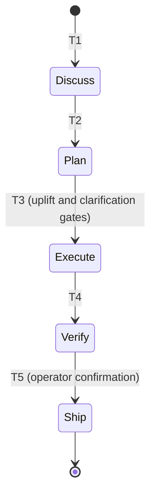

# Phase lifecycle state machine

Scope: `src/workflow/phase-loop.ts` on main (18aa68c). Line numbers refer to that 104-line file. Section 1 lists what main implements. Section 2 lists proposed transitions from ADR 0001 (`docs/adr/0001-persist-and-gate-the-phase-lifecycle.md`). Every proposed item is marked **Proposed**.

## 1. Implemented on main

### 1.1 States

There is no explicit state field. The state is the `phaseOrder` prefix (`PhaseLoopState.phaseOrder`, L24). The current state is its last element.

| State | Reached when | Source |
|---|---|---|
| (empty) | `phaseOrder` is `[]`; `rowFor` creates the row | L41 (`rowFor`, L36-49) |
| Discuss | `phaseOrder[0]` | L5 (`PHASE_ORDER`) |
| Plan | `phaseOrder[1]` | L5 |
| Execute | `phaseOrder[2]` | L5, L76-77 |
| Verify | `phaseOrder[3]` | L5 |
| Ship | `phaseOrder[4]`, via `confirmShip` | L95 |

Ship is terminal on main. Every later attempt is refused: `PHASE_ORDER[5]` is undefined, so L71 refuses any phase, and L93 refuses `confirmShip` because the last element is Ship, not Verify. There is no Close, Checkpointed, Paused, or Failed state.

### 1.2 Transitions

| ID | From to To | Function | Guard | Effect |
|---|---|---|---|---|
| T1 | (empty) to Discuss | `attemptPhase` | connected (L69); next in order (L71) | push (L76) |
| T2 | Discuss to Plan | `attemptPhase` | connected (L69); next in order (L71) | push (L76) |
| T3 | Plan to Execute | `attemptPhase` | connected (L69); next in order (L71); `completeUpliftCount >= 1` and `unansweredBlockingClarifications === 0` (L73-74) | push (L76); `executeStarts += 1` (L77) |
| T4 | Execute to Verify | `attemptPhase` | connected (L69); next in order (L71) | push (L76) |
| T5 | Verify to Ship | `confirmShip` | `afterVerify` (L92); last element is Verify (L93); connected (L94) | push (L95); `shipStarts = 1` (L96); `operatorConfirmations += 1` (L97) |

### 1.3 Refusals

A refused call returns a snapshot and leaves the state unchanged.

| ID | Refused when | Line |
|---|---|---|
| R1 | Runtime not connected (`attemptPhase`, `confirmShip`) | L69, L94 |
| R2 | `attemptPhase` with phase Ship | L70 |
| R3 | Phase is not the next in order | L71 |
| R4 | Execute gates unmet | L74 |
| R5 | `confirmShip` without `afterVerify` | L92 |
| R6 | `confirmShip` when the last element is not Verify, including a second confirmation after Ship | L93 |

`rowFor` creates a row even on a refused call (L68, L91).

### 1.4 Diagram

### 1.5 Observed gaps on main

- Nothing is persisted (L31, L34). A restart starts empty.
- `attemptPhase` guards Verify only by order and connection (L69, L71). No audit or validation is consulted.
- `confirmShip` (L86-99) consults no audit and no human item.
- Ship is the last state. No close transition exists.

## 2. Proposed transitions (ADR 0001)

Proposed states: **Checkpointed** and **Closed**. HTIL entries are a set attached to a phase; they are not a state.

### P1. Persist on transition (LIFE-01) — Proposed

- Each accepted transition T1 to T5 and each counter write (L77, L96-97) commits the `PhaseLoopState` to durable storage before the call returns.
- Refusals R1 to R6 write nothing.
- The store replaces the `loops` map (L34) as the system of record. A restart loads it, and the loaded state equals the last committed state.
- The storage backend is not decided.

### P2. Checkpoint on kill or pause; restore on resume (LIFE-04) — Proposed

- **Any implemented state** to **Checkpointed** on pause, or on a catchable kill. The checkpoint holds the state snapshot, the reason (`pause` or `kill`), and a timestamp.
- **Checkpointed** to the implemented state on resume. Resume restores the latest checkpoint and returns a restore report that lists each restored field: `phaseOrder`, `executeStarts`, `shipStarts`, `operatorConfirmations`.
- A hard kill writes no checkpoint. Resume then uses the last commit from P1.

### P3. Audit gate before Close (LIFE-02) — Proposed

- **T6 (Ship to Closed).** Guard: a recorded audit or validation result exists for the phase, referenced by ID.
- **T6-override (Ship to Closed).** Guard: a recorded owner-decision record exists, referenced by ID. It replaces the audit guard.
- Neither record present: refused, state unchanged.
- Closed is terminal.
- The milestone-complete gate is out of repo, in gsd-core at `/root/.agents/gsd-core`. Its internals are not designed here.

### P4. Human items as HTIL entries (LIFE-05) — Proposed

- On entry to Verify (T4), each human-verification or owner-gated item becomes an HTIL entry with an ID, an owner, and a state.
- T5 and T6 are refused while any HTIL entry is open.
- An entry leaves the open set only by resolution or by a recorded owner decision. Both are recorded.

### P5. Single writer (LIFE-03) — Proposed

- LIFE-03 adds no transition to this machine.
- Any STATE.md or ROADMAP.md write that records a transition above goes through the one guarded writer. The writer is in gsd-core, out of repo. A concurrent write fails loudly.

### 2.1 Open items (not decided here)

- Storage backend and checkpoint format (P1, P2).
- Whether a hard kill needs more than the last P1 commit.
- Where HTIL item sources come from (P4).
- The gsd-core interfaces for the milestone-complete gate and the writer (P3, P5).
