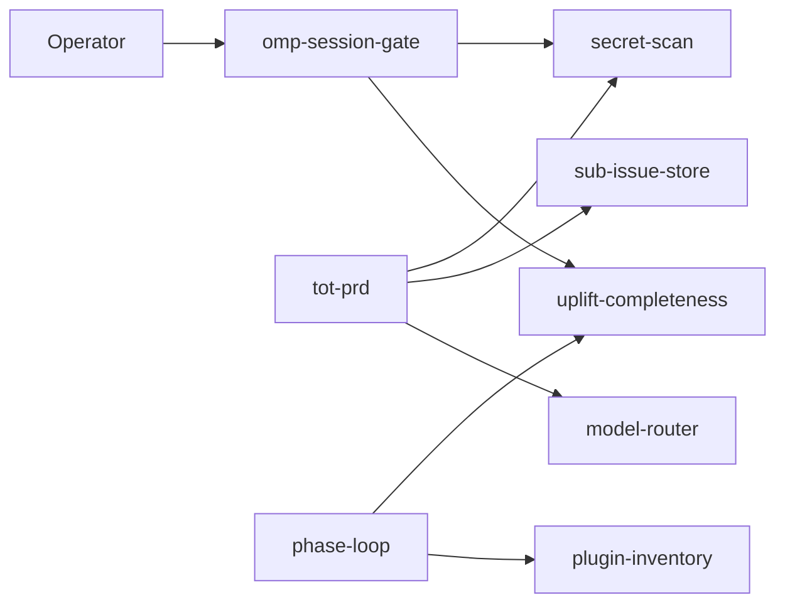

# Architecture blueprint — Tab6a

- Kind: `architecture.blueprint`
- Version: 1.0.0
- Task: `Tab6a-arch`
- Correlation: `ab6a76d6-3e64-4867-8476-b7acb5c4dee0`
- Status: in review
- Owner: A03
- Requirements: `docs/requirements/spec.md` 1.0.0 (VALIDATED). Requirement ids are unchanged.

This blueprint says how the VALIDATED requirements are built. It does not implement them. It does not add `omp` to GSD-Core, does not require `vscode`, and does not treat `pi` as `omp`.

The OpenAPI file is an in-process contract for A05, A06, A07, and A08. It is not a new HTTP server and not a public API.

## 1. Decision order

1. Catalog: no `infra.constraints` catalog was attached. Choices stay inside this repository: TypeScript on Bun, `src/host/omp.ts`, `src/uplift/xml.ts`, `src/track/plan.ts`, `src/redact.ts`, and `adapters/install.ts`. No new service, datastore, or first-party dependency. ADR-0001, ADR-0002, and ADR-0003 are L2.
2. Contract: `contracts/ultrathink-plugin-tab6a.openapi.json` version 1.0.0 is the cross-boundary interface. Downstream tasks must pin its digest.
3. NFR allocation: `arch_nfr_allocation` returned `fully_allocated: true`, `coverage_pct: 100`, `unallocated: []`. Bindings are in `docs/architecture/tab6a-nfr-bindings.md`.
4. Fitness: `arch_c4_fanout` returned `container_count: 8`, `relation_count: 7`, `max_fan_out: 3`, `over_budget: []`, `isolated: []` at budget 4. `arch_layer_violations` returned `violation_count: 0`. `arch_cycle_check` returned `has_cycle: false`. `shared_verdict` on an empty finding list returned `pass`.
5. Compatibility: there is no prior contract file. This is the first version. It is not a breaking revision of a published contract.
6. Boundaries: A03 does not write product code, change environments, or accept security risk. NFR-S1 and NFR-C1 go to A10. Implementation tasks must not open until A10 co-signs the threat model.

## 2. Context

The arrows are the dependency edges checked by the fitness tools. A module depends on the module it points to. The operator is outside that graph. Section 3 lists the same seven edges.

## 3. Containers

Layer order, outermost first: `host`, `workflow`, `core`. A module may depend on its own layer or a later layer. Fan-out budget is 4. Observed maximum is 3 (`tot-prd`).

| Container | Layer | Existing code | Responsibility |
|---|---|---|---|
| `omp-session-gate` | host | `src/host/omp.ts` | Primary Omp session wait. ADR-0001. |
| `phase-loop` | workflow | `hosts/cursor/gsd-commands/`, `src/cursor/pstack.ts` | Discuss, Plan, Execute, Verify, Ship. ADR-0003. |
| `plugin-inventory` | workflow | `adapters/install.ts`, host manifests | 18-id connection inventory. ADR-0003. |
| `tot-prd` | workflow | new stage beside `src/track/plan.ts` | Tree-of-Thought and one Code Blocked PRD. ADR-0002. |
| `model-router` | workflow | session model already snapshotted in `src/host/omp.ts` | Selected model versus cheapest callable model. ADR-0002. |
| `uplift-completeness` | core | `src/types.ts` `ROOT_TAGS`, `src/uplift/xml.ts` `REQUIRED_CHILDREN` | One closed uplift root and required children. |
| `sub-issue-store` | core | `src/track/plan.ts`, `src/track/types.ts` | Existing Chain-of-Thought sub-issue rows. |
| `secret-scan` | core | `src/redact.ts` | Zero secret-scan matches before delivery. A10 owns the verdict. |

Relations checked by `arch_c4_fanout`:

- `omp-session-gate` → `uplift-completeness`
- `omp-session-gate` → `secret-scan`
- `phase-loop` → `plugin-inventory`
- `phase-loop` → `uplift-completeness`
- `tot-prd` → `model-router`
- `tot-prd` → `sub-issue-store`
- `tot-prd` → `secret-scan`

No container is isolated. No edge points upward.

## 4. US-1 session gate

Evidence: `src/host/omp.ts` lines 6-8 and 1447. The handler races at 25000 ms and, on loss, returns `pendingMessage()`. The file comment states that the host caps a handler at 30 s and drops a late result. `maxRunMs` defaults to 0, which means no planner timeout.

That race does not meet US-1. A pending note is not the start of work. Blocking inside `before_agent_start` for 600000 ms would be dropped by the host cap and must not be built.

Required behavior, ADR-0001:

- Plannable prompt on the primary session: `before_agent_start` returns before 30000 ms. It does not return `pendingMessage()`. It does not return a partial or unclosed uplift. It does not authorize reads, edits, or commands.
- The flight keeps running. `maxRunMs` stays 0. The 600000 ms figure is a gate clock, not a planner timeout and not a minimum delay.
- Operator status during the wait uses the existing non-turning delivery `sendMessage` with `deliverAs: "nextTurn"` and `triggerTurn: false` (`src/host/omp-render.ts` `ACTIVITY_DELIVERY`) and the existing widget or `notify`. Status text is plain, at most 200 characters, includes the elapsed seconds as an integer, and uses the words `waiting` or `failed` so color is not the only signal. That status is not agent work context.
- The first work turn is the delivery of one complete uplift into agent context. Delivery uses the existing plan message only after `uplift-completeness` accepts it and `secret-scan` reports 0 matches.
- If the complete uplift arrives at T and 0 ms ≤ T ≤ 600000 ms, timeout-failure records stay 0 and that one uplift is delivered. A stall with 300000 ms ≤ T ≤ 600000 ms is progress, not a timeout failure.
- If no complete uplift exists at 600001 ms, work turns stay 0 and the record code is `UPLIFT_WAIT_EXCEEDED`. That code is not a timeout-failure code. Do not set `flight.timedOut`. Do not deliver `NO_PLAN` as a timeout.
- A non-plannable prompt waits 0 ms and is not replaced by a pending note.
- A subagent session returns immediately, as `isSubagentSession` already does. US-1 does not cover it.
- Completeness stays the existing rule: one closed root in `BUILD_PROMPT`, `FIX_PROMPT`, `RESEARCH_PROMPT`, `CHANGE_PROMPT`, or `UPLIFTED_PROMPT`, with `SYSTEM_ROLE`, `SCOPE`, `CONSTRAINTS`, `ACCEPTANCE_CRITERIA`, and `CONTEXT` or `APP_CONTEXT`, and the original operator text as the first child.

A work turn is a turn whose agent context contains one complete uplift, or any tool execution. A hold return with zero tool calls and zero complete-uplift context is not a work turn. Tool execution on a gated submission is blocked with the existing `ToolCallEventResult.block` until the gate opens.

## 5. US-2 Code Blocked PRD

Evidence: `src/track/plan.ts` writes one sub-issue row per Chain-of-Thought step. US-2 adds a document. It does not remove those rows. There is no published price table in this repository. A pricing network client would be novel infrastructure and is rejected (ADR-0002).

- Graph-of-Thought and Chain-of-Thought record the selected model id, the id selected when that stage starts. An empty id writes 0 PRDs and `PRD_NO_SELECTED_MODEL`.
- Tree-of-Thought runs only after that node's Chain-of-Thought steps are recorded. It records the cheapest callable model: lowest published input price in USD per 1000000 tokens. Equal prices break by Unicode code-point order of the model id, ascending. A model with no published input price is not compared.
- The price list is a caller-supplied catalog. Tests pass the AC-8 prices. Production reads prices the session already has. It does not call a new price service. If zero callable models have a published input price, 0 PRDs are written and the code is `PRD_NO_PRICE`.
- If the selected model is also the cheapest, Tree-of-Thought records that same id.
- The PRD count is 0 until Tree-of-Thought finishes. After it finishes, the node carries 1 Code Blocked PRD. The recorded CoT step count equals the number of recorded steps.
- The PRD contains the heading `Code Blocked PRD`, at least 1 fenced code block, and at least 1 line that starts with `Blocked until:`.
- `secret-scan` must report 0 matches before the PRD is attached or delivered. A03 does not accept a residual secret match.

## 6. US-3 connection inventory

The required set is the 18 CLI-installable runtime ids in `docs/requirements/spec.md` section 4. `vscode` is excluded. `gemini` returns `GSD_RETIRED_RUNTIME` and does not change the set size. `omp` is not in the set. `windsurf` alias `devin-desktop` is not a 19th id.

Connected means the inventory line `runtime=<id> status=connected` and at least one Ultrathink entry is loaded for that id. Zero entries yields `status=missing` and `PLUGIN_AGENT_MISSING`.

| Runtime id | Entry already in this repository | Inventory until an entry is loaded |
|---|---|---|
| `claude` | `.claude-plugin/plugin.json`, `adapters/claude-code` | connected only when that entry is loaded |
| `cursor` | `.cursor-plugin/plugin.json`, `hosts/cursor/` | connected only when that entry is loaded |
| `hermes` | `hosts/hermes/plugin.yaml`, `adapters/hermes` | missing and `PLUGIN_AGENT_MISSING` when 0 entries are loaded (AC-16) |
| `pi` | `package.json` key `pi.extensions` → `src/host/omp.ts` | distinct from `omp`; a pi pass is not an omp pass |
| `codex`, `antigravity`, `opencode`, `kilo`, `kimi`, `copilot`, `windsurf`, `cline`, `codebuddy`, `qwen`, `augment`, `trae`, `zcode`, `kimi-code` | no entry in this repository | missing and `PLUGIN_AGENT_MISSING` |

A05 adds the missing entries. This blueprint does not invent those hosts' install commands. An entry is loaded only when the inventory can see a manifest or adapter for that id. `package.json` also maps `omp.extensions` to the same file as `pi`. The inventory keys stay distinct. Loading that file for `pi` does not mark `omp` connected, and `omp` is not required.

Existing Ultrathink hosts that are not in the 18 (`grok-build`, `muse`, `prime-agent`, `omp`) stay as they are. This design neither removes them nor adds them to the required set.

## 7. US-4 semi-autonomous loop

On one connected runtime, the recorded phase order is Discuss, Plan, Execute, Verify, Ship. Existing command names in `src/cursor/pstack.ts` map discuss, plan, and execute commands. Verify is the spec name for the verify-work and review commands already listed there. Ship is the existing ship flow.

- Execute starts only after 1 complete uplift exists and unanswered blocking clarifications equal 0. Otherwise the Execute start count stays 0.
- Ship starts only after 1 operator confirmation that follows Verify. Otherwise the Ship start count stays 0.
- The operator does not re-enter each phase name. Blocking clarification answers, when any exist, are still required before Execute.
- Fully unattended Ship is out of scope. Assumption A-3 stands.

## 8. Supply chain and fitness

No new dependency is added. The licence of this plugin remains AGPL-3.0-or-later, as declared in `.claude-plugin/plugin.json`. SBOM and OSV status for a new catalog are `unknown` because no approved catalog was attached. Do not add a package to close that gap inside implementation.

Fitness functions CI must keep:

- Layer order `host`, `workflow`, `core`, with no upward edge.
- No dependency cycle among the eight modules.
- Fan-out at most 4.
- NFR allocation coverage 100 percent for NFR-P1, NFR-S1, NFR-A1, NFR-I1, and NFR-C1.
- Contract check of `contracts/ultrathink-plugin-tab6a.openapi.json` before a version bump.
- Secret-scan match count 0 on delivered uplift XML and each Code Blocked PRD. A10 runs that check. A waiver is not a pass.

## 9. What implementers must not do

- Do not raise `raceMs` to 600000.
- Do not add a minimum wait.
- Do not record `UPLIFT_WAIT_EXCEEDED` as a timeout failure.
- Do not call a new model-price API.
- Do not add `omp` as a GSD-Core runtime.
- Do not require `vscode`.
- Do not accept a secret-scan match.
